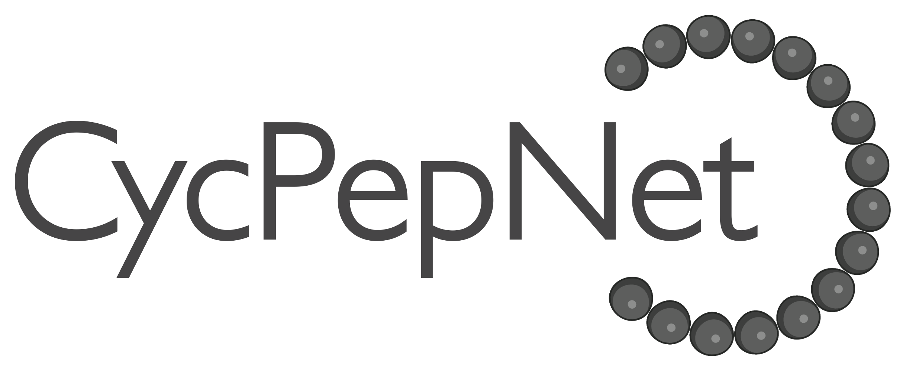
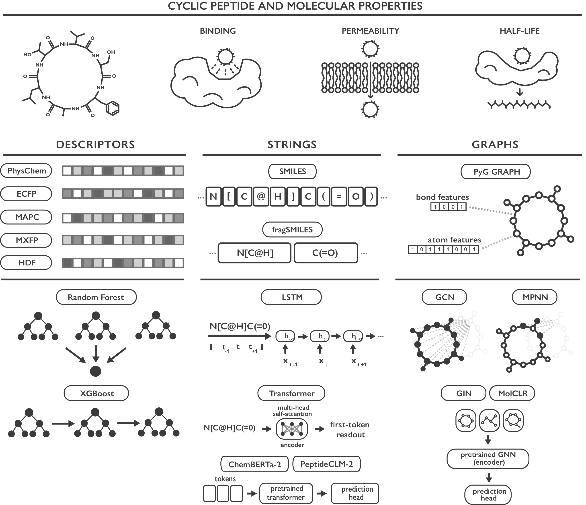

<p align="center">
  
</p>

<p align="center">
  
  
  
</p>

CycPepNet is an open framework that compares molecular representations and machine-learning models for cyclic-peptide **binding affinity, membrane permeability and half-life**. It accompanies *Assessing the predictive limits of machine learning on cyclic peptides* (Benito and Grisoni).

The framework covers 20 regression/classification tasks, 45 model configurations, two split methods and five training seeds. Saved run records allow every analysis and figure to be reproduced without retraining models.



## Installation

Clone the repository and pick one of the two environments:

```bash
git clone https://github.com/molML/CycPepNet.git
cd CycPepNet
```

Pixi is the reference: the published results were produced in it, and it is the only route with an exact lockfile.

```bash
pixi install --locked
```

Conda is the alternative, for the many setups where it is already in place:

```bash
conda env create -f environment.yml
conda activate cycpepnet
```

Either environment makes `cycpepnet` importable from the repository root. To use it elsewhere, `pip install -e .` installs the package with the analysis dependencies, and `pip install -e '.[train]'` adds the training stack.

Pixi locks Linux and Apple Silicon and installs the CUDA 12.8 PyTorch wheel; `environment.yml` sets the same floors without an exact lock and installs the default PyTorch build, so request a GPU build there if you intend to train. Windows is covered by neither, so use Linux or WSL. `make` targets mirror the `pixi run` tasks.

## Reproduce the results

The analysis stages read the reference run records, curated CSVs and released splits; no GPU, pretrained weights or fingerprint caches are required. Run them from the repository root:

```bash
pixi run python -m cycpepnet.verify
pixi run python -m cycpepnet.reproduce
pixi run python -m cycpepnet.verify --compare outputs/reproduction/results
```

This writes **85 CSV/TeX outputs and 17 PNG figures** to `outputs/reproduction/`, leaving the reference archive intact. These three commands are the one part of the repository that needs neither Pixi nor Conda; on **Python 3.12**, `pip install -e .` is enough for them.

`cycpepnet.verify` hashes the released artifacts and validates all 40 splits against the task tables they index. `cycpepnet.reproduce` runs the analysis stages in order, stops on the first failure and writes a `reproduction.json` marker only if every stage succeeds. `--compare` checks the regenerated CSV/TeX outputs against the release within `rtol=atol=1e-8`; figure bytes are not an equivalence criterion, since fonts and renderer versions differ between machines.

## Results and figures

`results/` is the reference archive of the published runs: 9,000 per-seed run records under `regression/` and `classification/`, 1,830 prediction archives, and the released tables below. Predictions exist for only part of the historical run set and cannot be reconstructed from metrics. `release-manifest.json` records the identity of every file there and lists the outputs that `python -m cycpepnet.verify --compare` re-checks after a reproduction.

Figures are written as PNG, manuscript figures under `main/` and Supporting Information under `supplementary/`, with `_companion` marking the Q²F3/AUROC version of a primary-metric figure. The manuscript carries the figure and table numbering; the tables below hold the numbers behind each panel.

| File | Contents |
|---|---|
| `splits_summary.csv`, `splits_diagnostics.csv` | Split sizes and diagnostics |
| `learnability.csv` | Per-task selection, test metrics, CIs |
| `statistical_tests.csv`, `tables/statistical_tests.tex` | Confirmatory comparisons, adjusted p |
| `tables/multiplicity_families.csv` | One row per p-value adjustment |
| `tables/regression_contrasts_by_task.csv` | Per-task regression comparisons |
| `tables/representation_ablation_*` | Ablations per task and per property |
| `method_ranking.csv` | Friedman and Nemenyi ranks |
| `kneedle_cutoffs.csv`, `cutoff_analysis.json` | Kneedle knee per fingerprint |
| `tables/statistical_tests_retired.csv` | Retired inferences and their replacements |

The retired numbers are regenerated by [`statistical_tests_nrmse_historical.py`](cycpepnet/analyze/statistical_tests_nrmse_historical.py), which no workflow calls.

`summary.csv` and `best_models_summary.csv` are runner aggregates rather than figure-workflow outputs; `python -m cycpepnet.runner --aggregate-only --results-root outputs/runs` regenerates them for a new experiment and also writes `validation_selected_models.csv`.

RMSE is reported in the units of each task's response, so it is never averaged or pooled across tasks: cross-task summaries use ranks, per-task min–max scores or dimensionless metrics. Any table selecting a configuration selects on the primary validation metric and reports on test; nothing is reselected on a companion metric.

## Getting started

### Train an included model on an included task

Every model family and every task is usable on its own. The loader reads a fingerprint cache that is not tracked, so generate it once from the released tables and point the loader at it:

```bash
pixi run python -m cycpepnet.prepare --dataset cycpeptmpdb --stage representations \
  --from-release --representations morgan_fp
export CYCPEPNET_DATA_ROOT=outputs/processed
```

This example then fits a Random Forest on physicochemical descriptors and scores it on the released Butina split:

```python
from cycpepnet.benchmark import BENCHMARK_TASKS
from cycpepnet.evaluation import RepType, evaluate_model
from cycpepnet.models.fps import RandomForestModel
from cycpepnet.utils.data_paths import get_processed_dataset_dir

task  = {t.name: t for t in BENCHMARK_TASKS}["cycpeptmpdb_reg"]
split = get_processed_dataset_dir(task.dataset) / "splits" / f"{task.name}_butina_morgan.json"
model = RandomForestModel(seed=0, task_type=task.task_type)

print(evaluate_model(task=task, model=model, rep_type=RepType.PHYSCHEM_ONLY, split_file=split))
```

### Evaluate your own model

Load any task table with its released split, train on `train`, choose hyperparameters on `val`, and score `test` with the same metric functions the framework uses. This needs no fingerprint caches and runs in any of the environments above, from the repository root:

```python
from cycpepnet.benchmark import BENCHMARK_TASKS, load_task_table
from cycpepnet.utils.data_paths import get_processed_dataset_dir
from cycpepnet.utils.metrics import evaluate
from cycpepnet.utils.splitting import load_split

task = {t.name: t for t in BENCHMARK_TASKS}["cycpeptmpdb_reg"]

frame, _ = load_task_table(task)
split, _ = load_split(get_processed_dataset_dir(task.dataset) / "splits" / f"{task.name}_butina_morgan.json")

smiles = frame["SMILES"].to_numpy()
y      = frame[task.target_column].to_numpy(float)
train, val, test = split["train"], split["val"], split["test"]

# Your model goes here:
y_pred = y[train].mean().repeat(len(test))

print(evaluate(y[test], y_pred, y[train]))
```

## Framework definition

Tasks live in [`cycpepnet/benchmark.py`](cycpepnet/benchmark.py); each has a regression (`_reg`) and a classification (`_cls`) form.

| Property | Positive class |
|---|---|
| Binding affinity | Ki/IC50 ≤ 100 nM |
| Permeability | log permeability ≥ −6 |
| Half-life | half-life ≥ 8 h |

Task names, with `†` marking the supplementary dataset-composition tasks:

```text
binding       macrocycledb_oprm1_ki  macrocycledb_mc4r_ki  macrocycledb_sstr2_ic50
permeability  cycpeptmpdb  npmmpd  †cycpeptmpdb_npmmpd  †cycpeptmpdb_townsend  †npmmpd_rzepiela
half-life     peplife2_pepmsnd_peptherdia  †half_life_peplife2
```

The model × representation matrix is `BENCHMARK_MATRIX` in [`cycpepnet/runner.py`](cycpepnet/runner.py); representations are the `RepType` enum in [`cycpepnet/evaluation.py`](cycpepnet/evaluation.py). Every non-baseline entry tunes hyperparameters with Optuna (50 trials) on the validation split. Analyses draw on a main pool of 22 configurations: the 44 less the higher-radius fingerprints and the PhysChem-augmented variants, which enter only the paired ablations.

| Family | Models | Representations |
|---|---|---|
| Baseline | `mean` | — |
| Fingerprints | RF (`rf_*`), XGBoost (`xgb_*`) | PhysChem, ECFP4/6 b/c, MAP4C/6C, MXFP, HDF |
| Strings | `lstm`, `transformer` | SMILES, fragSMILES |
| Graphs | `gcn`, `mpnn` | PyG graphs |
| Pretrained GNNs | `pretrained_gin`, `molclr` | PyG graphs |
| Pretrained CLMs | `chemberta2`, `peptide_clm2` | SMILES |

Each source keeps its own curator in `cycpepnet/process/process_<source>.py`; the permeability and half-life combinations are separate scientific steps in `cycpepnet/combine/`. Task filtering, duplicate handling, log transforms and classification thresholds are centralized in `benchmark.load_task_table`, which needs no fingerprints, so analysis and training apply identical row ordering and target transformations.

## Train models or rebuild datasets

Training and curation need the full environment from the installation above:

```bash
pixi run python -m cycpepnet.prepare --dataset macrocycledb --stage representations \
  --from-release --representations morgan_fp
pixi run python -m cycpepnet.runner --tasks macrocycledb_mc4r_ki_reg --models mean \
  --seeds 0 --split-method butina_morgan --data-root outputs/processed
```

To rebuild curation and representations from the provider inputs, acquire them first as described under [Input data](#input-data):

```bash
python -m cycpepnet.verify --inputs-only
pixi run python -m cycpepnet.prepare --stage curate --original-root data/original
pixi run python -m cycpepnet.prepare --stage representations
pixi run python -m cycpepnet.benchmark --data-root outputs/processed
```

## Input data

The framework snapshot is nine exact provider files. They are **not distributed with this repository**: acquire each one from its provider under the terms that provider sets. [`data/sources.csv`](data/sources.csv) records each one with its SHA-256 hash, acquisition link and review status; [`data/source-evidence.json`](data/source-evidence.json) holds the evidence and comparisons behind that review. Those two files carry the reviewed licensing status of every source.

| Source | Property | Reference |
|---|---|---|
| **CycPeptMPDB** | Permeability | Li et al., *J. Chem. Inf. Model.* **2023**, 63, 2240 |
| **Macrocycle-DB** | Binding affinity | Jiang et al., *Nucleic Acids Res.* **2026**, 54, D1469 |
| **NPMMPD** | Permeability | Feng et al., *Sci. Data* **2025**, 12, 10 |
| **PEPlife2** | Half-life | Alam et al., *Immuno* **2026**, 6, 26 |
| **PepMSND** | Half-life | Hu et al., *Digital Discovery* **2025**, 4, 2478 |
| **PepTherDia** | Half-life | D'Aloisio et al., *Drug Discovery Today* **2021**, 26, 1409 |

Place inputs under `data/original/<source>/` with the filenames in the inventory, then verify their identities without needing curated tables, splits or results:

```bash
python -m cycpepnet.verify --inputs-only
python -m cycpepnet.verify --inputs-only --original-root /path/to/original
```

This establishes file identity, not redistribution rights. Keep the framework snapshots fixed: released split indices refer to the task-filtered, deduplicated table, so replacing an input with a current provider export invalidates the comparison.

### Acquiring each input

- **CycPeptMPDB** — `CycPeptMPDB_Peptide_All.csv` from the official download link, which matched the recorded hash over HTTP (HTTPS failed) during review. Verify the hash before use.
- **Macrocycle-DB** — `All.csv`, `Biological Activities.csv`, `Linker.csv`, `Target-All.csv`. Request the historical versions matching the inventory; the live export API is a lead, not a verified recipe.
- **NPMMPD** — the local `Overall.csv` (6,362 rows) is a different snapshot from Figshare v1 (5,638 rows). Request the matching version; do not substitute v1.
- **PEPlife2** — recover the original export query and its selected fields for `Peplife 2.0.csv`; the sequence FASTA downloads are not a substitute.
- **PepMSND** — download [PepMSND.zip](https://zenodo.org/api/records/15687572/files/PepMSND.zip/content) and read the member `PepMSND/Dataset/Dataset.xlsx` (member SHA-256 `787de5f5c5fd47a5e34a278fb7fced926825d7a5112428f5548ba8a8d69afd33`). Its cell contents are equivalent but its bytes differ, so the strict input check will reject it by design: it must not silently replace the framework snapshot.
- **PepTherDia** — preserve the existing CSV. The maintainer confirmed website scraping on 2026-09-28, but the input has no source-page ID/URL or retrieval-date column, and the exact cyclic-selection predicate, scraper and page order have not been recovered. A new scrape of the live database cannot be assumed to recreate the historical input, and the selection must not be inferred from current bond types.

### Curated tables

`data/processed/<dataset>/` holds the curated CSVs and the released split indices under `splits/`. Fingerprint, graph and fragSMILES caches are not tracked; `python -m cycpepnet.prepare --stage representations` regenerates them, and their manifests refuse caches whose ordered SMILES or implementation hash do not match.

## How to cite

If you use CycPepNet, cite the preprint:

> Benito, M.; Grisoni, F. *Assessing the predictive limits of machine learning on cyclic peptides*. ChemRxiv, 2026. [10.26434/chemrxiv.15011871/v1](https://doi.org/10.26434/chemrxiv.15011871/v1)

```bibtex
@misc{benito2026cycpepnet,
  title     = {Assessing the predictive limits of machine learning on cyclic peptides},
  author    = {Benito, Markel and Grisoni, Francesca},
  year      = {2026},
  publisher = {ChemRxiv},
  doi       = {10.26434/chemrxiv.15011871/v1},
  url       = {https://doi.org/10.26434/chemrxiv.15011871/v1}
}
```

Please also cite the original data providers listed above.

## License

Code is distributed under the [MIT License](LICENSE); it does not cover the third-party data. For questions, open an issue or pull request.

The curated tables are **modified** derivatives, not provider archives. Only the PepMSND Zenodo deposit has a verified data license, [CC BY 4.0](https://creativecommons.org/licenses/by/4.0/): keep its attribution to Hu and the PepMSND authors, [DOI 10.5281/zenodo.15687572](https://doi.org/10.5281/zenodo.15687572), the license link and this modification notice when redistributing. [`data/sources.csv`](data/sources.csv) holds the review status of the other five.
